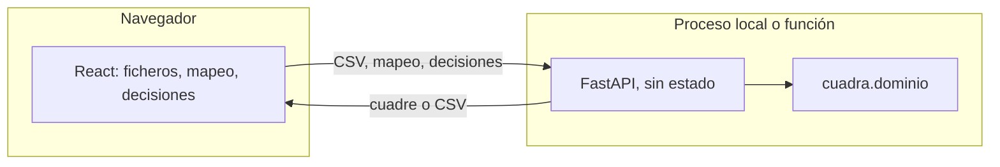

# Cuadra

Cuadra compara dos exportaciones de inventario en CSV y enseña qué cambió, qué falta y qué no se puede emparejar con seguridad. No adivina equivalencias: la clave es exacta y la ambigüedad se queda a la vista. No sustituye a un ERP.

El corte de esta versión es un recorrido completo: cargar A y B (o la demostración), mapear columnas, reconciliar, decidir fila a fila con motivo, exportar y guardar la sesión para reabrirla. No hay cuentas ni base de datos. El servidor no guarda los ficheros.

## Cómo ejecutarlo en local

Hacen falta Python 3.12 y Node 22.

```bash
cd backend
python3 -m venv .venv
source .venv/bin/activate
pip install -e ".[dev]"
pytest
uvicorn cuadra.api.app:app --host 127.0.0.1 --port 43124
```

En otra terminal:

```bash
cd frontend
npm install
npm run dev
```

La interfaz queda en [http://127.0.0.1:43123](http://127.0.0.1:43123) y el proxy de Vite envía `/api` al puerto 43124.

El recorrido de punta a punta:

```bash
cd e2e
npm install
npx playwright install chromium
npm test
```

`pytest` cubre el dominio y la API (61 tests). Playwright cubre un solo recorrido: demostración, exportación bloqueada, decisiones con motivo, exportación completa, guardar sesión y reabrirla.

## Arquitectura

El dominio en Python no importa FastAPI ni React. La interfaz solo habla HTTP. Vite, y no Next.js, porque el cuadre es una sola herramienta en el navegador: no hay páginas que renderizar en el servidor ni SEO que cuidar, y la API ya vive en FastAPI.



| Pieza | Dónde | Qué hace |
| --- | --- | --- |
| Tipos y reglas | `backend/src/cuadra/dominio` | Lee, valida, empareja, decide, exporta, abre la sesión |
| HTTP | `backend/src/cuadra/api` | Traduce JSON. No conserva archivos |
| Contrato visible | `fixtures/` | Pares de CSV ficticios con su JSON esperado |
| Pantalla | `frontend/` | El mismo contrato, en español |
| Recorrido | `e2e/` | Playwright |

## Reglas

### Números

Tras recortar espacios, la cantidad tiene que coincidir con un entero o un decimal con punto: signo menos opcional, sin separador de miles, sin coma decimal y con hasta 4 decimales. La parte entera tiene como mucho 12 dígitos. `10`, `10.5`, `10.50`, `-3` y `-0` se aceptan. `10.50` y `-0` se guardan como `10.5` y `0`. Se rechazan `1,5`, `01`, `+5`, `1.23456` y el texto.

El punto es siempre decimal. `1.000` vale uno, no mil. La coma no se interpreta como decimal aunque el CSV use punto y coma: si el origen vino así, se corrige el origen.

### Descripciones e identificadores

Se recortan espacios al principio y al final. No se tocan los espacios internos, ni las mayúsculas, ni los acentos. `tuerca` y `Tuerca` son distintas. `Clavo  de acero` y `Clavo de acero` también. Una descripción vacía es válida. Un identificador vacío, o hecho solo de espacios, bloquea la fila.

`ab` y `AB` no son la misma clave.

### Duplicados y filas que no se pueden comparar

Si un identificador aparece más de una vez en un fichero, todas esas filas quedan bloqueadas y no se fusionan. La misma clave en el otro fichero también se bloquea, aunque allí sea única: emparejar «una de las dos» sería adivinar. Una fila con cantidad inválida, identificador vacío o fórmula bloquea esa clave en los dos ficheros.

Una fila a la que le faltan columnas queda bloqueada y el resto del fichero sigue. Si falta una columna entera, el delimitador es ambiguo, el fichero no es UTF-8, pasa de 1 MiB o pasa de 2 000 filas, no hay cuadre parcial: el error nombra el fichero y, cuando existe, la fila y la columna.

### Filas que solo están en un fichero

| Situación | Se puede | No se puede | Qué se exporta si se acepta |
| --- | --- | --- | --- |
| Solo en A | Conservar A, cantidad manual o excluir | Conservar B | Identificador y descripción de A. La cantidad es la de A o la manual |
| Solo en B | Conservar B, cantidad manual o excluir | Conservar A | Igual, con los valores de B |
| Iguales | Entran solas. También se pueden excluir o ajustar la cantidad | — | Los valores compartidos, u origen `manual` |
| Modificado, misma descripción | A, B, cantidad manual o excluir | — | El lado elegido, o la descripción común con la cantidad manual |
| Modificado, descripción distinta | A, B o excluir | Cantidad manual | Descripción y cantidad del lado elegido |
| Bloqueada | Nada, hasta corregir el origen | Cualquier decisión | Solo aparece en el historial |

Toda decisión lleva un motivo no vacío. Excluir una fila no la borra del historial.

### Delimitador y fórmulas

Se mira la cabecera, fuera de las comillas. Si solo hay comas, el delimitador es la coma. Si solo hay punto y coma, es ese. Si hay los dos, hay que elegirlo: Cuadra no elige en silencio. Un punto y coma dentro de un campo entre comillas no cuenta.

Una celda de identificador o descripción que empieza por `=`, `+`, `-`, `@`, tabulación, retorno o salto de línea se bloquea. En la cantidad, el menos inicial solo es válido si el resto es un número. Al exportar, cualquier texto que aún empiece por esos caracteres se prefija con `'`. Las cantidades canónicas, aunque sean negativas, se escriben como número.

La exportación usa siempre coma, UTF-8 sin BOM y salto de línea `\n`. Las líneas que empiezan por `#` son metadatos. La columna `marca_exportacion` vale `COMPLETA` o `PARCIAL`.

La exportación completa se rechaza mientras haya pendientes o bloqueados. La parcial sale con `parcial` en el nombre (`cuadra-inventario-parcial.csv`, `cuadra-historial-parcial.csv`) y con `PARCIAL` en el contenido. El historial lista cada fila de origen. Por eso ninguna desaparece: las excluidas llevan motivo y las bloqueadas siguen anotadas.

### Sesión

El archivo `cuadra-sesion.json` trae `schema_version` 1, el SHA-256 de cada CSV después de quitar un BOM inicial, el delimitador, el mapeo y las decisiones. Al reabrir se exige la misma versión y los mismos bytes. Una decisión ilegal o una clave desconocida rechaza el archivo entero, con un mensaje legible. No se aplica a medias.

El mismo CSV y las mismas decisiones producen el mismo cuadre y los mismos bytes de exportación.

## Límites

| Límite | Valor |
| --- | --- |
| Tamaño por fichero | 1 048 576 bytes (1 MiB), tras quitar el BOM |
| Filas de datos por fichero | 2 000. Pasarse rechaza el fichero entero, no un prefijo |
| Columnas | 40 |
| Identificador | 200 caracteres |
| Descripción y motivo | 500 caracteres |
| Decimales | 4 |

El cliente los consulta en `GET /api/limites` y también corta el archivo antes de enviarlo. El servidor los vuelve a aplicar. Cabecera en la interfaz y en esta página.

## Qué no hace

No abre Excel, PDF ni imágenes. No hace OCR, no llama a un modelo, no empareja por similitud, no se conecta a otro sistema, no tiene cuentas ni colaboración, y no guarda nada entre peticiones.

## Despliegue en Vercel

No está desplegado. El repositorio deja la configuración para un proyecto cuya raíz sea este directorio, no `frontend/`:

- `vercel.json` construye el frontend (`npm ci` y `npm run build` en `frontend/`) y publica `frontend/dist`.
- `api/index.py` es la función Python. Añade `backend/src` al path e importa la app FastAPI. `api/requirements.txt` lista FastAPI y Pydantic.
- Las rutas están en `/api/...` y también sin ese prefijo, por si la plataforma entrega la ruta ya recortada.
- No hace falta ninguna variable secreta. No hay base de datos.
- Dos ficheros de 1 MiB más el JSON caben bajo el límite de 4,5 MB del cuerpo de una función.

Para publicarlo más adelante: crear el proyecto en Vercel apuntando a este directorio, sin cambiar el comando de build, y no activar nada que persista archivos. Este corte no ejecuta ese paso.
