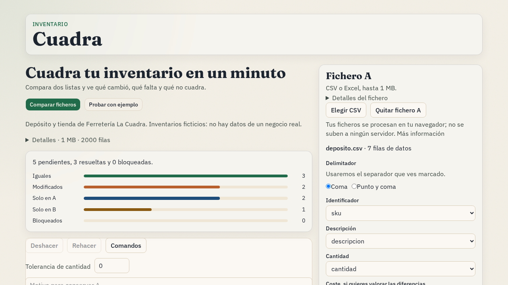
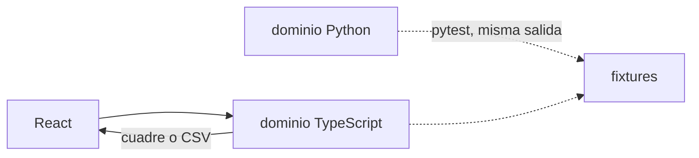

# Cuadra

Cuadra compara dos exportaciones de inventario en CSV y enseña qué cambió, qué falta y qué no se puede emparejar. La clave es exacta: no adivina equivalencias y no sustituye a un ERP. El cuadre ocurre en el navegador. Los ficheros no se envían a ningún servidor.




## Probarlo en treinta segundos

Hace falta Node 22. Python 3.12 solo si quieres correr la referencia.

```bash
cd frontend && npm install && npm run dev
```

Abre [http://127.0.0.1:43123](http://127.0.0.1:43123). La muestra de Ferretería La Cuadra ya está cargada y cuadrada. Es inventario ficticio. Funciona sin red después de la primera carga: hay un service worker en producción.

La referencia Python, que no hace falta para usar la app:

```bash
cd backend && python3 -m venv .venv && source .venv/bin/activate && pip install -e ".[dev]" && pytest
```

## Tus propios CSV

1. Elige el fichero A y el B (CSV o Excel `.xlsx`). El Excel se convierte a CSV en el navegador.
2. Si el texto no es UTF-8, se lee como Windows-1252 y se avisa.
3. Confirma el delimitador. Si la cantidad usa coma decimal, pulsa «Convertir comas decimales». Cuadra no lo hace solo.
4. Mapea identificador, descripción y cantidad. El coste es opcional y no entra en el emparejamiento.
5. Compara, decide fila a fila con motivo, y exporta.

Atajos: `Ctrl` o `⌘` + `K` abre los comandos. `Ctrl` o `⌘` + `Z` deshace una decisión (no el texto que estás escribiendo). `Mayús` + eso rehace.

El borrador y las plantillas de columnas se guardan solo si los activas, y solo en este navegador. Hay un botón para borrar el borrador.

## Qué no hace

No adivina que dos claves se parecen. No abre PDF ni imágenes. No tiene cuentas. No envía los CSV a un servidor. No hay analítica mientras `VITE_GA_ID` esté vacío. Las páginas `/legal` y `/legal-en` dicen «Texto legal pendiente de revisión».

Por encima de 2 000 filas o 1 MiB por fichero no hay cuadre: se rechaza el archivo entero. 50 000 filas quedan fuera de este corte. El detalle está en [docs/auditoria.md](docs/auditoria.md).

## Para quien revisa el código

Vite y React. El dominio que usa la pantalla está en TypeScript (`frontend/src/dominio/cuadra.ts`). El Python de `backend/src/cuadra/dominio` es la implementación de referencia: no se despliega. Vitest comprueba que las dos salidas coinciden sobre `fixtures/`.



El dominio rechaza el parecido a propósito: emparejar «una de las dos» filas duplicadas sería inventar. Las iguales entran solas. Toda decisión manual lleva motivo. La exportación completa se bloquea mientras haya pendientes o bloqueados.

| Comprobación | Dónde |
| --- | --- |
| Referencia Python | `cd backend && pytest` (61 tests) |
| Paridad y pantalla | `cd frontend && npm run test:unit` |
| Lint y build | `cd frontend && npm run lint && npm run build` |
| Recorrido | `cd e2e && npm test` |

Licencia MIT, Sebastián Zaruha, 2026. Cómo desplegarlo, sin API y sin tocar DNS: [docs/despliegue.md](docs/despliegue.md).

### Más adelante

Archivos de decenas de miles de filas, tolerancia de precio dentro del dominio y los textos legales definitivos. Motivos en la auditoría.

## English

Cuadra compares two inventory CSV exports in the browser and shows what changed, what is missing, and what cannot be matched safely. Keys are exact. Files are not uploaded. Open the app and the fictional hardware-store sample is already reconciled. The Python package stays in the repo as the reference implementation and is not part of the Vercel deploy. `/legal` and `/legal-en` are placeholders pending counsel. Analytics stay off until `VITE_GA_ID` is a real measurement id and the visitor accepts.
