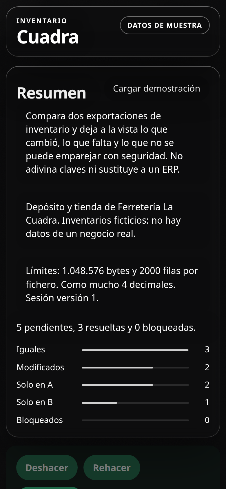
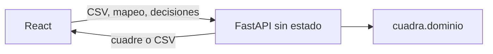

# Cuadra

Cuadra compara dos exportaciones de inventario en CSV y enseña qué cambió, qué falta y qué no se puede emparejar. La clave es exacta: no adivina equivalencias y no sustituye a un ERP. El servidor responde y olvida los ficheros.




## Probarlo en treinta segundos

Hacen falta Python 3.12 y Node 22.

```bash
cd backend && python3 -m venv .venv && source .venv/bin/activate && pip install -e ".[dev]"
uvicorn cuadra.api.app:app --host 127.0.0.1 --port 43124
```

```bash
cd frontend && npm install && npm run dev
```

Abre [http://127.0.0.1:43123](http://127.0.0.1:43123). La muestra de Ferretería La Cuadra ya está cargada y cuadrada. Es inventario ficticio.

## Tus propios CSV

1. Elige el fichero A y el B (CSV o Excel `.xlsx`). El Excel se convierte a CSV en el navegador.
2. Si el texto no es UTF-8, se lee como Windows-1252 y se avisa.
3. Confirma el delimitador. Si la cantidad usa coma decimal, pulsa «Convertir comas decimales». Cuadra no lo hace solo.
4. Mapea identificador, descripción y cantidad. El coste es opcional y no entra en el emparejamiento.
5. Reconcilia, decide fila a fila con motivo, y exporta.

Atajos: `Ctrl` o `⌘` + `K` abre los comandos. `Ctrl` o `⌘` + `Z` deshace una decisión (no el texto que estás escribiendo). `Mayús` + eso rehace.

El borrador y las plantillas de columnas se guardan solo si los activas, y solo en este navegador. Hay un botón para borrar el borrador.

## Qué no hace

No adivina que dos claves se parecen. No abre PDF ni imágenes. No tiene cuentas. No guarda los CSV en el servidor. No hay analítica. Los textos de privacidad, aviso legal y cookies están pendientes de revisión del asesor.

Por encima de 2 000 filas o 1 MiB por fichero no hay cuadre: el servidor rechaza el archivo entero. 50 000 filas quedan fuera de este corte porque cada decisión reenvía los dos CSV y el cuerpo de una función en Vercel tiene un tope de 4,5 MB. El detalle está en [docs/auditoria.md](docs/auditoria.md).

La conciliación necesita la API Python (`/api`, puerto 43124 en local). La interfaz se puede instalar como PWA y el cascarón carga sin red; sin la API no hay cuadre nuevo. La API no persiste ficheros.

## Para quien revisa el código

Vite y React en el navegador. FastAPI delante de un dominio Python que no importa el framework. El contrato visible está en `fixtures/`.



El dominio rechaza el parecido a propósito: emparejar «una de las dos» filas duplicadas sería inventar. Las iguales entran solas. Toda decisión manual lleva motivo. La exportación completa se bloquea mientras haya pendientes o bloqueados.

| Comprobación | Dónde |
| --- | --- |
| Dominio y API | `cd backend && pytest` (61 tests) |
| Lógica de pantalla | `cd frontend && npm run test:unit` |
| Lint y build | `cd frontend && npm run lint && npm run build` |
| Recorrido | `cd e2e && npm test` |

Accesibilidad: `lang="es"`, nombres en los controles, diálogo de comandos con foco atrapado, contraste del texto secundario sobre el fondo oscuro, `prefers-reduced-motion`.

Cómo desplegarlo, sin tocar DNS desde este repositorio: [docs/despliegue.md](docs/despliegue.md).

### Más adelante

Archivos de decenas de miles de filas, cuadre offline (hoy las reglas viven solo en Python), tolerancia de precio dentro del dominio y los textos legales definitivos. Motivos en la auditoría.

## English

Cuadra compares two inventory CSV exports and shows what changed, what is missing, and what cannot be matched safely. Keys are exact. It does not guess, it does not replace an ERP, and the server does not store the files. Open the app and the fictional hardware-store sample is already reconciled. Your own CSV or Excel stays in the browser until you send it to the API for that request only. Privacy, legal notice and cookie pages are placeholders pending counsel.
